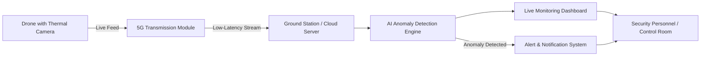

# 🚁 Drone-Based Thermal Anomaly Detection System for Border Security (5G-Enabled)

An intelligent border surveillance system that uses **5G-connected drones** equipped with **thermal imaging cameras** to detect anomalies — such as unauthorized human or vehicle movement — in real time, even in low-visibility and nighttime conditions.

---

## 📌 Table of Contents

- [Overview](#-overview)
- [Problem Statement](#-problem-statement)
- [Proposed Solution](#-proposed-solution)
- [Key Features](#-key-features)
- [System Architecture](#-system-architecture)
- [Tech Stack](#-tech-stack)
- [Prerequisites](#-prerequisites)
- [Installation](#-installation)
- [Usage](#-usage)
- [Project Structure](#-project-structure)
- [Dataset](#-dataset)
- [Anomaly Detection Approach](#-anomaly-detection-approach)
- [Results](#-results)
- [Future Scope](#-future-scope)
- [Team](#-team)
- [Contributing](#-contributing)
- [License](#-license)
- [Acknowledgments](#-acknowledgments)

---

## 🌍 Overview

Border areas are often remote, vast, and difficult to monitor continuously using manual patrolling or fixed CCTV infrastructure. This project proposes a **drone-based aerial surveillance system** that streams live thermal video over a **low-latency 5G network** to a ground station, where an AI model analyzes the feed in real time to flag potential security anomalies and alert response teams instantly.

## 🎯 Problem Statement

- Manual border patrolling is labor-intensive, slow, and limited by terrain and visibility.
- Traditional CCTV/IR cameras are static and have limited coverage.
- Poor lighting, fog, and nighttime conditions reduce the effectiveness of regular optical cameras.
- Delayed detection of intrusions can compromise national security.

## 💡 Proposed Solution

A fleet of drones fitted with **thermal (infrared) cameras** patrols designated border zones, capturing heat-signature video regardless of lighting conditions. The video is transmitted over **5G** for near-zero latency streaming to a ground/cloud server, where a **deep learning model** performs real-time anomaly detection (e.g., human intrusion, unattended objects, vehicle movement) and triggers instant alerts to security personnel via a live dashboard.

## ✨ Key Features

- 📡 **Real-time video streaming** over 5G with ultra-low latency
- 🌡️ **Thermal imaging** for 24/7 operation, including night and low-visibility conditions
- 🤖 **AI-based anomaly detection** (intrusion, unusual heat signatures, unauthorized vehicles)
- 🗺️ **Autonomous/waypoint-based drone navigation** with GPS geo-tagging
- 🚨 **Automated alert system** (dashboard, SMS/email/app notifications)
- 📊 **Live monitoring dashboard** for control room operators
- 🗂️ **Anomaly logging** with timestamp and location for post-event analysis

## 🏗️ System Architecture



## 🛠️ Tech Stack

**Hardware**
- Quadcopter drone frame with flight controller (e.g., Pixhawk/APM)
- Thermal imaging camera (e.g., FLIR Lepton/Boson)
- 5G communication module
- GPS module

**Software / Backend**
- Python (core processing & AI pipeline)
- OpenCV (image/video processing)
- PyTorch / TensorFlow (deep learning model)
- YOLOv8 or custom CNN/autoencoder for anomaly detection
- Flask / FastAPI (backend API)
- MQTT / RTSP / WebRTC (video & data transmission)

**Frontend / Dashboard**
- React.js (or HTML/CSS/JS)
- Chart.js / Leaflet.js (for maps & analytics)

**Database & Cloud**
- MongoDB / Firebase
- AWS / Azure (optional, for cloud deployment)


## 📋 Prerequisites

- Python 3.9+
- Node.js 18+ (if using a web dashboard)
- pip / virtualenv
- Drone hardware with thermal camera and 5G module (or simulated/sample thermal video dataset for software-only demo)

## ⚙️ Installation

```bash
# Clone the repository
git clone https://github.com/<your-username>/<repo-name>.git
cd <repo-name>

# Create and activate a Python 3.11 virtual environment
python3.11 -m venv .venv
source .venv/bin/activate      # On Windows: .venv\Scripts\activate

# Install CPU-only PyTorch for local inference without an NVIDIA GPU
python -m pip install torch torchvision --index-url https://download.pytorch.org/whl/cpu

# Install the remaining backend dependencies
pip install -r requirements.txt

# (Optional) Install frontend dependencies
cd dashboard
npm install
```

## 🚀 Usage

```bash
# Activate .venv first, then start the local YOLO video inference API
python thermal-streaming/inference_api.py

# Start the browser dashboard in a second terminal
cd dashboard
npm run dev
```

Open the Vite URL (usually `http://localhost:5173`), choose a local video, adjust the confidence threshold if needed, and run inference. The browser displays the original clip and annotated MP4 side by side. The API uses `ai-model/weights/best2_compatible.pt` and FFmpeg; install FFmpeg if it is not already available on your system.

## 📁 Project Structure

```
├── drone-control/          # Drone navigation & flight control scripts
├── thermal-streaming/      # 5G video capture & streaming modules
├── ai-model/                # Anomaly detection model, training & inference
│   ├── dataset/
│   ├── train.py
│   └── inference.py
├── backend/                 # API server, alert system
├── dashboard/                # Frontend monitoring dashboard
├── requirements.txt
└── README.md
```

## 📊 Dataset

- **HIT-UAV** supplies aerial thermal imagery with official train/validation/test splits and object bounding boxes. In the HIT-UAV-only run, the evaluated labels were person, car, and bicycle; the `other_vehicle` category had few labeled instances. `DontCare` annotations were excluded.
- **AIResQ** was added as a higher-quality search-and-rescue dataset. The combined training setup maps labels to `person` and `vehicle`; HIT-UAV car/bicycle/other-vehicle categories are combined as `vehicle`. AIResQ annotations available for this run were person-only, so its missing vehicle labels must be treated as unlabeled during training and excluded from vehicle performance interpretation.
- **FLIR ADAS** was used in earlier experiments as a ground-view thermal dataset. Its camera perspective differs from aerial imagery, so report FLIR results separately.
- These datasets support object detection, not a validated border-anomaly decision. That requires additional operational context, data, or temporal logic.
- Cite Suo et al., [HIT-UAV, *Scientific Data* 10, 227 (2023)](https://doi.org/10.1038/s41597-023-02066-6), and the [AIResQ dataset record](https://zenodo.org/records/19677785) when describing the datasets.


## 🧠 Anomaly Detection Approach

- **Object detection-based:** Fine-tuned YOLO model to detect humans/vehicles in thermal frames.
- **Unsupervised anomaly detection:** Autoencoder trained on "normal" thermal patterns; frames with high reconstruction error are flagged as anomalies.
- Post-processing includes confidence thresholding and geo-tagging of detected anomalies.

## 📈 Results

### Evaluation results

The following are the reported Ultralytics validation metrics from two runs. The HIT-UAV-only evaluation covers 1,366 images and 11,679 instances. The combined HIT-UAV + AIResQ evaluation covers 571 images and 4,780 instances on the reported test split. These are separate evaluations with different data distributions and split sizes; they should not be interpreted as a controlled before/after comparison unless the same held-out images and evaluation configuration were used.

| Dataset / run | Class | Images | Instances | Precision | Recall | mAP@0.50 | mAP@0.50:0.95 |
|---|---:|---:|---:|---:|---:|---:|---:|
| HIT-UAV only | All | 1,366 | 11,679 | 0.774 | 0.664 | 0.761 | 0.413 |
| HIT-UAV only | Person | 1,206 | 5,778 | 0.825 | 0.692 | 0.814 | 0.421 |
| HIT-UAV only | Car | 1,292 | 5,431 | 0.835 | 0.829 | 0.893 | 0.592 |
| HIT-UAV only | Bicycle | 338 | 470 | 0.660 | 0.472 | 0.577 | 0.226 |
| HIT-UAV + AIResQ | All | 571 | 4,780 | 0.857 | 0.834 | 0.871 | 0.575 |
| HIT-UAV + AIResQ | Person | 355 | 2,611 | 0.860 | 0.890 | 0.913 | 0.477 |
| HIT-UAV + AIResQ | Car | 267 | 1,339 | 0.909 | 0.963 | 0.980 | 0.720 |
| HIT-UAV + AIResQ | Bicycle | 86 | 796 | 0.896 | 0.835 | 0.909 | 0.568 |
| HIT-UAV + AIResQ | Other vehicle | 21 | 34 | 0.761 | 0.647 | 0.681 | 0.534 |

**Metric definitions:** Precision (P) is the fraction of predicted detections that match a labeled object; recall (R) is the fraction of labeled objects detected; mAP@0.50 averages class average precision at IoU 0.50; mAP@0.50:0.95 averages over IoU thresholds 0.50 through 0.95. Values are copied from the run summaries shown above and rounded to three decimal places.

**Interpretation limits:** The combined run reports the original HIT-UAV class names, while the refined training plan uses `person` and `vehicle` with vehicle subtypes merged. Preserve each run's actual label mapping when preparing the report. AIResQ is person-only labeled in the current setup, so do not infer AIResQ vehicle accuracy from these metrics. The displayed output does not establish statistical significance, real-world border performance, or 5G end-to-end alert latency. Include checkpoint, Ultralytics version, image size, confidence/IoU settings, and exact split provenance in the final report if available.

## 🔮 Future Scope

- Swarm-based multi-drone coordination for wider coverage
- Edge AI deployment on the drone itself to reduce dependency on network latency
- Integration with satellite imagery for broader situational awareness
- Predictive analytics for anticipating intrusion patterns

## 👥 Team

| Name | Role |
|---|---|
| Yash Raj | TBD |
| Akshit Kumar | TBD |
| Prashant Pratap Singh | TBD |

**Institution:** Birla Institute of Technology, Mesra

## 🤝 Contributing

Contributions are welcome! Please fork the repository, create a feature branch, and submit a pull request.

## 📄 License

This project is licensed under the [MIT License](LICENSE).

## 🙏 Acknowledgments

- Sanjeet Kumar, ECE | BIT Mesra
- Open-source thermal imaging datasets and research referenced during development
